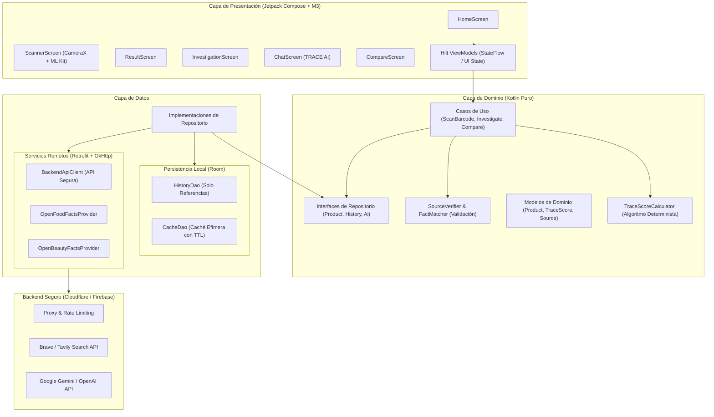

# Arquitectura del Sistema - TRACE

Este documento describe la arquitectura de software de la aplicación Android TRACE, los límites de sus capas, el flujo de datos para la investigación de productos y las medidas de seguridad adoptadas.

---

## 🏛️ Diagrama General de Capas

---

## 🔄 Flujo de Datos de una Investigación

1. **Captura:** El usuario enfoca un código de barras en `ScannerScreen`. CameraX y Google ML Kit leen el valor numérico (ej. EAN-13: `3017620422003`).
2. **Despacho:** El `ScannerViewModel` delega a `InvestigateProductUseCase`.
3. **Consulta de Fuentes Directas:** El repositorio consulta `OpenFoodFactsProvider` / `OpenProductsFacts` según la categoría detectada.
4. **Búsqueda Web Complementaria:** Si los datos son insuficientes o requieren corroboración de materiales/fabricante, se solicita al `BackendApiClient` una búsqueda estructurada.
5. **Verificación y Coincidencia:** `SourceVerifier` analiza los fragmentos obtenidos, validando que el código o la combinación exacta de marca + nombre coincida con el producto investigado. Los datos no verificados se aíslan.
6. **Cálculo del TRACE SCORE:** `TraceScoreCalculator` recibe los factores verificados (materias primas, fabricación, reparabilidad, reciclabilidad, etc.) y calcula la puntuación ponderada (0–100) y su nivel de confianza (Alto, Medio, Bajo).
7. **Presentación:** Los resultados enriquecidos se emiten mediante `StateFlow` hacia `ResultScreen` e `InvestigationScreen`.
8. **Interacción con TRACE AI:** Si el usuario abre el chat, `ChatViewModel` envía la pregunta junto al contexto estricto de las fuentes verificadas hacia `POST /v1/ai/chat` en el backend seguro.

---

## 🛡️ Límites de Seguridad y Privacidad
- **Cero Claves en el APK:** Las credenciales de APIs de pago o de IA residen únicamente en las variables de entorno del backend (`backend/.env`).
- **Defensa contra Prompt Injection:** Cualquier texto extraído de páginas web o fuentes abiertas se envía a la IA etiquetado como dato no confiable (*untrusted content*), con instrucciones de sistema estrictas que prohíben ejecutar directivas contenidas en los datos.
- **Transparencia Total de Fuentes:** Cada afirmación relevante muestra su URL de origen, fecha de consulta, fragmento citado y estado de verificación (*confirmada*, *declarada*, *estimada*, *no encontrada*).
